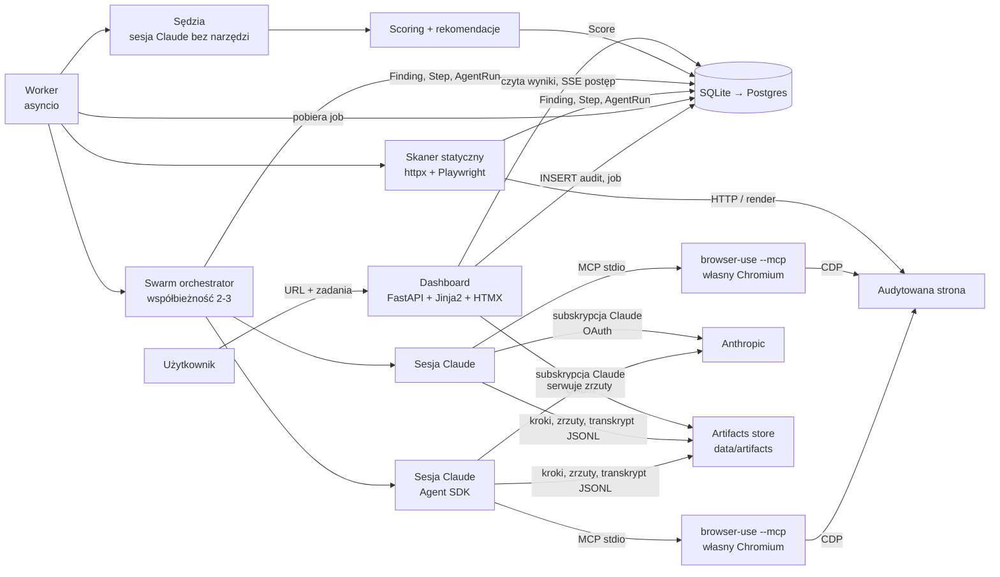
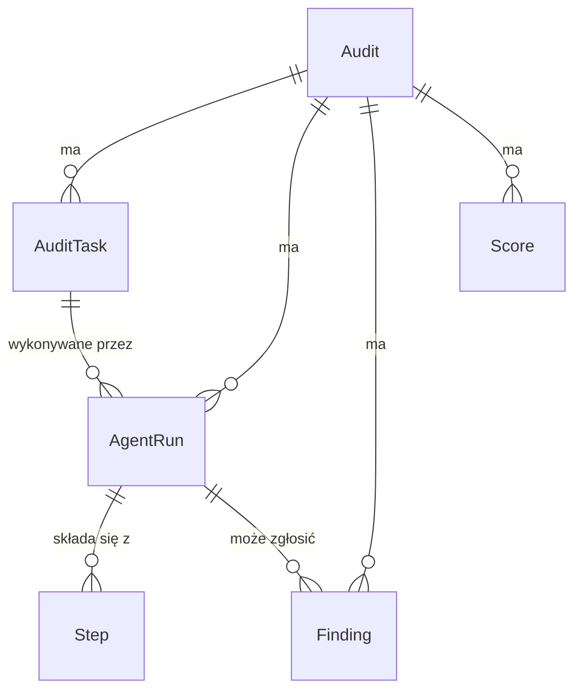

# Agent-Ready Audit — plan i architektura

> Status: **szkic do akceptacji** (2026-11-20). Kod i identyfikatory po angielsku, dokumentacja po polsku.
> Decyzje i otwarte pytania są zebrane w sekcji [13](#13-decyzje-i-otwarte-pytania).
> **Zdecydowane 2026-11-20:** agenci działają na subskrypcji Claude Karola (bez klucza API), na domowym PC (§2).

## Spis treści

1. [Cel i zakres](#1-cel-i-zakres)
2. [Decyzja: agenci na subskrypcji Claude + fakty o narzędziach](#2-decyzja-agenci-na-subskrypcji-claude-bez-klucza-api--fakty-o-narzędziach)
3. [Architektura](#3-architektura)
4. [Model danych](#4-model-danych)
5. [Skaner statyczny — lista sprawdzeń](#5-skaner-statyczny--lista-sprawdzeń)
6. [Rój agentów — persony i zadania (YAML)](#6-rój-agentów--persony-i-zadania-yaml)
7. [Metodologia punktacji (0–100)](#7-metodologia-punktacji-0100)
8. [Roadmapa (fazy z kryteriami akceptacji)](#8-roadmapa-fazy-z-kryteriami-akceptacji)
9. [Układ repozytorium](#9-układ-repozytorium)
10. [Bezpieczeństwo i etyka](#10-bezpieczeństwo-i-etyka)
11. [Kontrola kosztów i limitów](#11-kontrola-kosztów-i-limitów)
12. [Abstrakcja backendu agentów](#12-abstrakcja-backendu-agentów)
13. [Decyzje i otwarte pytania](#13-decyzje-i-otwarte-pytania)

---

## 1. Cel i zakres

**Cel:** narzędzie, które odpowiada na pytanie *„czy asystent AI poradzi sobie na mojej stronie?”*.
Użytkownik podaje URL i listę zadań (np. „znajdź produkt i dojdź do checkoutu”, „załóż konto”, „zaloguj się”,
„porównaj oferty”). Narzędzie:

1. robi **skan statyczny** strony (robots.txt i reguły dla botów AI, llms.txt, sitemap, schema.org, semantyczny
   HTML/ARIA, etykiety formularzy, blokady botów/CAPTCHA, publiczne API/MCP/NLWeb),
2. wypuszcza **rój agentów przeglądarkowych** (sesje Claude sterujące przeglądarką przez MCP browser-use), które zachowują się jak osobisty asystent
   użytkownika: przeglądają, szukają, logują się, dodają do koszyka — i nagrywa każdy krok,
3. liczy **Agent-Readiness Score 0–100** i pokazuje w **dashboardzie webowym** raport: co agenci zrobili,
   gdzie utknęli, ile to kosztowało i co poprawić.

**W zakresie (MVP):**
- dashboard webowy od pierwszej fazy (lista audytów, formularz nowego audytu, szczegóły audytu, raport),
- skan statyczny z wynikiem częściowym,
- agenci = sesje Claude (subskrypcja, Agent SDK) + MCP browser-use na lokalnym Chromium, persony i zadania w YAML,
- zapis kroków: zrzuty ekranu, kod/akcje agenta, błędy, czas, koszt,
- rekomendacje poprawek powiązane z konkretnymi znaleziskami.

**Poza zakresem (na razie):**
- prawdziwe płatności i finalizacja zamówień (agent zatrzymuje się przed ostatnim krokiem — patrz §10),
- obchodzenie CAPTCHA / stealth (mierzymy, *czy* zwykły agent jest blokowany, a nie jak blokadę ominąć),
- multi-tenant SaaS, logowanie użytkowników dashboardu, płatności za narzędzie,
- audyt stron, do których nie mamy uprawnień.

## 2. Decyzja: agenci na subskrypcji Claude (bez klucza API) + fakty o narzędziach

**Decyzja Karola (2026-11-20): nie używamy klucza API.** Agenci działają na **subskrypcji Claude (Pro/Max)
Karola, na jego domowym PC**. Warstwa agentów = **Claude Code w trybie headless**, sterowany z Pythona przez
**Claude Agent SDK** (`claude-agent-sdk`), który korzysta z lokalnego logowania Claude Code albo z tokena
`CLAUDE_CODE_OAUTH_TOKEN` (z `claude setup-token`). Przeglądarką steruje przez **serwer MCP browser-use**
(browser-use zostaje w stacku); zapasowo **Playwright MCP**. Każdy agent roju = jedna sesja Claude z własną
przeglądarką i własnym profilem.

### 2.1 Fakty (sprawdzone 2026-11-20 w dokumentacji i w kodzie paczek)

| Fakt | Konsekwencja dla projektu |
|---|---|
| **Claude Agent SDK dla Pythona**: `claude-agent-sdk` **0.2.186** (Python ≥3.10), zawiera wbudowane CLI Claude Code (można wskazać własne przez `cli_path`). `query()` / `ClaudeSDKClient` zwracają typowane wiadomości (`AssistantMessage`, `ResultMessage`, …). `ClaudeAgentOptions`: `mcp_servers`, `strict_mcp_config`, `tools`, `allowed_tools`, `disallowed_tools`, `permission_mode`, `max_turns`, `max_budget_usd`, `model`, `system_prompt`, `output_format`, `hooks`, `env`, `cwd`. | Główny backend agentów: natywnie async, pasuje do workera. `output_format` daje ustrukturyzowany wynik zadania, `hooks` (np. `PostToolUse`) — log kroków na żywo. |
| **Claude Code CLI** (`@anthropic-ai/claude-code` **2.1.329**): `claude -p "<zadanie>" --output-format stream-json --verbose` (stream-json w trybie `-p` wymaga `--verbose`), `--mcp-config <plik/JSON>`, `--strict-mcp-config`, `--allowedTools`, `--disallowedTools`, `--tools ""` (wyłącza wbudowane narzędzia), `--permission-mode dontAsk` (odmawia wszystkiego, co nie jest dozwolone), `--max-turns`, `--model sonnet\|haiku\|opus`, `--append-system-prompt`, `--no-session-persistence`. | Równoważny backend „surowy” (`claude -p` + parsowanie JSONL) — do debugowania i jako zapas, gdyby SDK sprawiało problemy. |
| **Logowanie subskrypcją**: `claude setup-token` generuje roczny token OAuth (wymaga subskrypcji), ustawiany jako `CLAUDE_CODE_OAUTH_TOKEN`. **`--bare` nie czyta tego tokena** (wymaga klucza API). | Nie używamy `--bare`. Token tylko w lokalnym `.env`, nigdy w repo. |
| **Zasady Anthropic** (dokumentacja Agent SDK): bez wcześniejszej zgody zewnętrzni deweloperzy nie mogą oferować logowania claude.ai ani limitów subskrypcji w swoich produktach. | Tryb subskrypcji = **wyłącznie użytek osobisty Karola na jego maszynie**. Udostępnienie narzędzia innym (faza 5) wymaga backendu `api` z kluczem. |
| **Limity subskrypcji**: Pro/Max mają limity użycia w oknach czasowych; równoległe sesje zużywają je szybciej. `total_cost_usd` w wyniku to **szacunek po cenach API**, a nie rachunek. | Domyślna współbieżność roju **2** (konfigurowalna, rozsądnie 2–3); orkiestrator pauzuje rój po błędzie limitu. Koszt w dashboardzie = „równowartość API (szacunek)”. |
| **browser-use 1.0.6** (2026-11-16, Python ≥3.11, przypinać `==`): nowy agent na Pydantic AI, steruje Chrome przez surowe CDP (`browser-harness`), **nie używa Playwrighta**. Ma **serwer MCP**: `browser-use --mcp` (także `python -m browser_use.mcp`) uruchamia **własny Chromium** z tymczasowym profilem i wystawia narzędzia `browser_exec` (Python z helperami `goto_url`, `click_at_xy`, `type_text`, `page_info`, `js`, `cdp`…), `browser_screenshot`, `browser_login`, `browser_feedback`. Ograniczenie domen: `BROWSER_USE_ALLOWED_DOMAINS`. | **Wybór: MCP browser-use.** Jeden proces serwera MCP na sesję = osobna przeglądarka i profil dla każdego agenta. `browser_login` (chmura Browser Use) blokujemy. |
| Zastrzeżenia MCP browser-use: CLI oznacza nazwę `--mcp` jako przestarzałą (nadal działa i jest jedynym trybem z własnym Chromium; `--cli-mcp` steruje *Twoim* otwartym Chrome — tego nie chcemy). Serwer nie wystawia opcji `headless`/profilu — Chromium jest headless tylko bez ekranu. Kod z `browser_exec` wykonuje się w procesie serwera (widzi jego zmienne środowiskowe). | Serwer MCP uruchamiamy z minimalnym `env` (bez sekretów). Na Linuksie bez okien: Xvfb albo kontener; na Windows/macOS okna Chromium będą widoczne. Wersja przypięta, test kontraktowy narzędzi MCP w CI. |
| **Playwright MCP** (`@playwright/mcp` **0.0.86**): `--headless`, `--isolated` (profil w pamięci), `--user-data-dir`, `--viewport-size`, `--output-dir`, `--allowed-origins`/`--blocked-origins` (nie są barierą bezpieczeństwa), `--caps vision`. | **Zapas** (backend `playwright_mcp`), gdy MCP browser-use się zmieni albo zawiedzie. Lepsza kontrola headless/viewport (persony mobilne). |
| Playwright (Python) **1.65.2**. | Nadal używany w **skanerze statycznym** (render JS, snapshot ARIA, zrzut strony) i jako źródło Chromium. |
| browser-use jako biblioteka (`Agent(...)`, wbudowany sędzia `judgement`, `cost_usd`) wymaga własnego modelu przez API. | Dostępne tylko w opcjonalnym backendzie `api` (§12). W trybie subskrypcji sędzia jest nasz (§7.2). |

## 3. Architektura

### 3.1 Wybór stacku dashboardu: FastAPI + Jinja2 + HTMX

**Decyzja:** jeden proces webowy **FastAPI**, widoki renderowane po stronie serwera w **Jinja2**, interaktywność
przez **HTMX** (polling/SSE statusu audytu, częściowe odświeżanie), styl: Pico.css lub prosty własny CSS.
Bez osobnego frontendu w JS i bez kroku budowania.

Dlaczego:
- Karol zna ten układ z `ai-personal-assistant` (FastAPI + Jinja2) — zero nowej technologii.
- Cały projekt w jednym języku (Python), jedno `uv run` uruchamia wszystko.
- HTMX wystarcza do „żywego” widoku audytu (status, postęp agentów, nowe zrzuty) przez SSE albo polling co 2 s.
- Ten sam backend wystawia JSON API (`/api/...`), więc gdyby kiedyś był potrzebny bogatszy frontend
  (React/Svelte), można go dodać bez przepisywania logiki.

Odrzucone: Streamlit/Gradio (szybki start, ale słaba kontrola nad długimi zadaniami w tle i nad URL-ami
raportów), osobny SPA w React (podwójna praca na etapie MVP), Django (cięższy niż potrzeba).

### 3.2 Komponenty

| Komponent | Odpowiedzialność | Technologia |
|---|---|---|
| **Web / dashboard** | Formularz audytu, lista, szczegóły, raport, podgląd na żywo, JSON API. | FastAPI, Jinja2, HTMX |
| **Kolejka zadań** | Audyty są długie (minuty). Web tylko zapisuje `Audit(status=queued)`; worker je odbiera. | Tabela `jobs` w bazie + osobny proces workera (polling; w Postgresie `SELECT ... FOR UPDATE SKIP LOCKED`). Bez Redisa w MVP. |
| **Worker** | Wykonuje pipeline audytu: skan statyczny → rój agentów → scoring → rekomendacje. | `python -m agent_ready.worker`, asyncio, `Semaphore` na liczbę równoległych sesji |
| **Skaner statyczny** | Zestaw niezależnych „checków” (HTTP + render Playwright). | `httpx`, `playwright` (Chromium), `selectolax`/`extruct` |
| **Agent runner** | Uruchamia jeden `AgentRun`: persona + zadanie → jedna sesja Claude (Agent SDK) z serwerem MCP przeglądarki; zapisuje kroki ze strumienia wiadomości, zrzuty z `browser_screenshot`, wynik i zużycie. | `claude-agent-sdk`, `browser-use==1.0.6 --mcp` (zapas: `@playwright/mcp`) |
| **Sędzia** | Po biegu osobna, krótka sesja Claude bez narzędzi ocenia transkrypt + ostatnie zrzuty wg `success_criteria` i zwraca JSON (sukces, powód porażki, blokada bota, prompt injection, „pułapki”). | `claude-agent-sdk` z `output_format` |
| **Swarm orchestrator** | Rozkłada macierz persona × zadanie × powtórzenia na równoległe sesje z limitami (współbieżność, limit subskrypcji, rate limit na domenę). | asyncio |
| **Scoring + rekomendacje** | Liczy wyniki kategorii i końcowy 0–100; mapuje znaleziska na poprawki. | czysty Python |
| **Storage** | Audyty, biegi, kroki, znaleziska, wyniki. | SQLAlchemy 2 / SQLModel + Alembic; **SQLite** na start, **Postgres** później |
| **Artifacts store** | Zrzuty ekranu, transkrypty (JSONL), HTML snapshoty, raporty. | Interfejs `ArtifactStore`; `LocalArtifactStore` (`data/artifacts/...`), później S3/MinIO |
| **Agent backend** | Jedno miejsce, które z konfiguracji wybiera sposób uruchamiania agenta. | `agent_ready/agents/backends/` (§12): `claude_sdk` (domyślny), `claude_cli`, `api` (opcjonalny) |

### 3.3 Diagram



### 3.4 Przepływ audytu

1. `POST /audits` (formularz): URL, wybrany zestaw zadań (YAML z biblioteki albo wklejony), liczba powtórzeń,
   budżet. Walidacja: domena na liście dozwolonych (§10), potwierdzenie uprawnień.
2. Worker: `status=static_scan` → checki statyczne → `Finding`-i + `Score(layer=static)`.
3. `status=agents` → macierz biegów → każdy bieg zapisuje `AgentRun` + `Step`-y + zrzuty, kroki widać na żywo.
4. `status=scoring` → `Score(layer=agent)`, `Score(layer=overall)`, rekomendacje.
5. `status=done` (albo `failed` / `cancelled` / `budget_exceeded`). Dashboard pokazuje raport.

### 3.5 Jak wygląda jedna sesja agenta (szkic)

```python
# src/agent_ready/agents/backends/claude_sdk.py (szkic)
from claude_agent_sdk import ClaudeAgentOptions, query

options = ClaudeAgentOptions(
    model=persona.model or settings.claude_model,          # alias: "sonnet" | "haiku" | "opus"
    system_prompt={"type": "preset", "preset": "claude_code", "append": persona_and_rules},
    mcp_servers={
        "browser": {
            "command": "uvx",
            "args": ["browser-use==1.0.6", "--mcp"],
            "env": {"BROWSER_USE_ALLOWED_DOMAINS": target_domain},   # bez sekretów!
        }
    },
    strict_mcp_config=True,                 # ignoruj MCP z ~/.claude.json i .mcp.json
    tools=[],                               # żadnych wbudowanych narzędzi (Bash, Read, WebFetch...)
    allowed_tools=["mcp__browser__browser_exec", "mcp__browser__browser_screenshot"],
    disallowed_tools=["mcp__browser__browser_login"],
    permission_mode="dontAsk",              # wszystko spoza allowlisty jest odrzucane
    max_turns=task.max_steps,
    output_format=task_result_schema,       # JSON: reached_goal, final_url, notes...
    cwd=run_workdir,                        # osobny katalog na bieg
)
async for message in query(prompt=task_prompt, options=options):
    recorder.record(message)                # Step-y, zrzuty (bloki image w wynikach narzędzi), ResultMessage
```

Równoważnik CLI (backend `claude_cli`, do debugowania):

```bash
claude -p "$TASK_PROMPT" --output-format stream-json --verbose \
  --mcp-config run_mcp.json --strict-mcp-config --tools "" \
  --allowedTools "mcp__browser__browser_exec mcp__browser__browser_screenshot" \
  --disallowedTools "mcp__browser__browser_login" \
  --permission-mode dontAsk --max-turns 40 --model sonnet --no-session-persistence
```

Prompt agenta każe mu robić `browser_screenshot` po każdej istotnej akcji (te obrazy zapisujemy jako zrzuty
kroków) i nie wpisywać adresów z pamięci. Dokładne nazwy narzędzi MCP (`mcp__<serwer>__<narzędzie>`)
sprawdza test kontraktowy w fazie 2.

## 4. Model danych



| Encja | Kluczowe pola |
|---|---|
| **Audit** | `id` (uuid7), `target_url`, `target_domain`, `status` (`queued`/`static_scan`/`agents`/`scoring`/`done`/`failed`/`cancelled`/`budget_exceeded`/`paused_limit`), `config` (JSON: zadania, persony, powtórzenia, limity, model), `budget_usd`, `cost_usd`, `created_at`, `started_at`, `finished_at`, `permission_confirmed` (bool + kto/kiedy) |
| **AuditTask** (w spec: *Task*) | `id`, `audit_id`, `task_key` (np. `checkout_reach`), `goal` (tekst dla agenta), `success_criteria`, `stop_before` (np. „przycisk płatności”), `weight`, `expected_steps`, `max_steps`, `timeout_s`, `requires_credentials` |
| **AgentRun** | `id`, `audit_id`, `task_id`, `persona_key`, `repeat_index`, `backend` (`claude_sdk`/`claude_cli`/`api`), `model` (np. `sonnet`), `session_id`, `status` (`queued`/`running`/`succeeded`/`failed`/`blocked`/`timeout`/`max_steps`/`paused_limit`/`error`), `raw_status` (z `ResultMessage`/backendu), `success_agent` (werdykt agenta), `success_judge` (werdykt sędziego), `success_final`, `steps_count`, `turns`, `duration_s`, `tokens_in`, `tokens_out`, `cost_estimate_usd` (równowartość API, szacunek), `final_result`, `failure_reason`, `bot_block_detected`, `prompt_injection_detected`, `gotchas` (JSON), `transcript_path`, `error` |
| **Step** | `id`, `run_id`, `index`, `ts`, `kind` (`code`/`tool`/`observation`/`log`/`error`), `action_summary` (np. „click #add-to-cart”), `code` (kod komórki REPL), `output` (zredagowany), `url`, `screenshot_path`, `error` |
| **Finding** | `id`, `audit_id`, `run_id?`, `layer` (`static`/`agent`), `category` (§5/§7), `check_key` (np. `robots.ai_bots_blocked`), `severity` (`info`/`low`/`medium`/`high`/`critical`), `status` (`pass`/`warn`/`fail`/`error`/`skipped`), `title`, `evidence` (JSON: fragment robots.txt, selektor, URL, nr kroku), `recommendation_key` |
| **Score** | `id`, `audit_id`, `layer` (`static`/`agent`/`overall`), `category` (`null` = suma warstwy), `value` (0–100), `max_points`, `points`, `details` (JSON z rozbiciem), `methodology_version` (np. `2026.1`) |

Uwagi:
- `methodology_version` na każdym wyniku — zmiana wag nie psuje porównań historycznych.
- Kroki zapisujemy na bieżąco ze strumienia wiadomości sesji Claude: każde wywołanie narzędzia MCP
  (`browser_exec` z kodem, `browser_screenshot`) = `Step`, wynik narzędzia = `output`, bloki obrazów = zrzuty.
  Pełny strumień zapisujemy też jako transkrypt JSONL. Dashboard pokazuje kroki na żywo (SSE/HTMX).
- Zrzuty ekranu nie trafiają do bazy, tylko ścieżka w `ArtifactStore`:
  `artifacts/{audit_id}/runs/{run_id}/step_{index:03}.png`.

## 5. Skaner statyczny — lista sprawdzeń

Każdy check to klasa z `key`, `category`, `run(ctx) -> list[Finding]` i punktami. Nowy check = nowy plik +
test na zapisanym HTML-u (fixture), bez dotykania reszty.

| Kategoria (waga w warstwie statycznej) | Checki |
|---|---|
| **Dostęp i polityka botów (25)** | robots.txt istnieje i się parsuje; czy blokuje znane boty AI/agentów (GPTBot, ChatGPT-User, OAI-SearchBot, ClaudeBot, Claude-User, PerplexityBot, Google-Extended, …) — osobno *crawlery treningowe* (informacyjnie) i *agenty działające w imieniu użytkownika* (punktowane); czy strona odpowiada 200 dla UA agenta vs zwykłej przeglądarki; wykrycie WAF/challenge (Cloudflare, Akamai, DataDome, hCaptcha/reCAPTCHA/Turnstile) już na GET |
| **Odkrywalność (15)** | `/llms.txt` (i `/llms-full.txt`) istnieje i ma poprawny format; `sitemap.xml` (z robots lub domyślny) dostępny i aktualny; kanoniczne URL-e; czytelne URL-e |
| **Dane strukturalne (20)** | JSON-LD/microdata schema.org: `Organization`, `WebSite` + `SearchAction`, `Product`/`Offer` (cena, dostępność, waluta), `BreadcrumbList`; OpenGraph; poprawność wymaganych pól |
| **Semantyka i dostępność (25)** | landmarki (`main`, `nav`, `header`), hierarchia nagłówków; przyciski/linki z dostępną nazwą (snapshot ARIA z Playwright); `<label>`/`aria-label` w formularzach, `autocomplete` na polach login/rejestracja/adres; `alt` obrazków; elementy klikalne będące `div`-ami bez roli; treść widoczna bez JS vs po renderze |
| **Interfejsy maszynowe (15)** | publiczne API / OpenAPI (`/openapi.json`, linki w `<link rel>`); `/.well-known/` (np. `mcp`, `ai-plugin.json`, `security.txt`); endpoint MCP; NLWeb (`/ask`, `/mcp`); RSS/feedy produktowe |

Zasady: limit żądań (domyślnie ≤1 req/s na domenę), własny User-Agent identyfikujący narzędzie
(`AgentReadyAudit/0.x (+URL repo)`), timeouty, wynik checka `error` nie obniża punktów, tylko jest raportowany.

## 6. Rój agentów — persony i zadania (YAML)

Biblioteka w `tasks/` i `personas/` (w repo), możliwość wklejenia własnego YAML w formularzu audytu.

### 6.1 Persona

```yaml
# personas/busy_parent.yaml
key: busy_parent
name: "Zabiegany rodzic"
description: >
  Asystent kupujący w imieniu użytkownika, który ma mało czasu.
  Wybiera najprostszą ścieżkę, nie czyta regulaminów, porzuca, gdy coś trwa za długo.
locale: pl-PL
instructions: |          # dopisywane do system promptu sesji Claude (append)
  Działasz jako osobisty asystent użytkownika. Działaj jak człowiek: korzystaj z wyszukiwarki
  i nawigacji strony, nie wpisuj URL-i z pamięci. Nigdy nie finalizuj płatności.
viewport: {width: 1280, height: 800}   # albo mobile: {width: 390, height: 844}
model: default            # albo alias Claude: haiku | sonnet | opus
backend: default          # claude_sdk (domyślnie); "api" tylko z kluczem (persona = inny asystent)
browser_mcp: default      # browser_use | playwright (np. persona mobilna z --viewport-size)
```

### 6.2 Zadanie

```yaml
# tasks/ecommerce_checkout.yaml
key: checkout_reach
title: "Znajdź produkt i dojdź do checkoutu"
category: commerce        # commerce | account | discovery | support
weight: 3                 # waga w warstwie agentów
goal: |
  Znajdź na {target_url} {product_query} w cenie do {max_price} zł, dodaj do koszyka
  i przejdź do kroku płatności. Zatrzymaj się na stronie wyboru płatności.
params:
  product_query: "słuchawki bezprzewodowe"
  max_price: 300
stop_before:              # twarde punkty zatrzymania (wstrzykiwane do promptu + sprawdzane przez sędziego)
  - "kliknięcie 'Zapłać' / 'Kupuję i płacę' / 'Place order'"
  - "podanie danych karty"
success_criteria: |       # trafia do promptu sędziego
  Sukces: agent jest na stronie checkoutu/płatności z produktem w koszyku i NIE złożył zamówienia.
output_schema:            # opcjonalnie -> output_format sesji (JSON Schema generowany z YAML)
  product_name: str
  price: float
  reached_checkout: bool
expected_steps: 15        # bazowa liczba kroków do oceny efektywności
max_steps: 40
timeout_s: 600
requires_credentials: false
```

```yaml
# tasks/account_login.yaml
key: login
title: "Zaloguj się na konto testowe"
category: account
weight: 2
goal: "Zaloguj się na {target_url} danymi użytkownika i otwórz stronę 'Moje konto'."
credentials_ref: test_account_1   # nazwa sekretu z .env / magazynu sekretów, nigdy wartość w YAML
success_criteria: "Sukces: widoczna strona konta zalogowanego użytkownika."
expected_steps: 6
max_steps: 20
timeout_s: 300
requires_credentials: true
```

### 6.3 Plan roju (w konfiguracji audytu)

```yaml
swarm:
  personas: [busy_parent, careful_researcher, mobile_shopper]
  tasks: [checkout_reach, login, signup]
  repeats: 2               # powtórzenia każdej pary -> stabilność wyniku
  concurrency: 2           # równoległe sesje Claude (limity subskrypcji!)
  per_domain_rps: 1        # łączny limit dla wszystkich agentów
  budget_usd: 5.00         # twardy limit kosztu audytu
```

Macierz = persony × zadania × powtórzenia (tu 3 × 3 × 2 = 18 biegów).

## 7. Metodologia punktacji (0–100)

Wersja metodologii: `2026.1`. Wagi trzymamy w `scoring/weights.yaml`, żeby można je stroić bez zmian w kodzie.

### 7.1 Warstwa statyczna (S, 0–100)

Suma punktów z kategorii §5 (25 + 15 + 20 + 25 + 15 = 100). W kategorii każdy check ma punkty;
`pass` = pełne, `warn` = połowa, `fail` = 0, `error`/`skipped` = wyłączone z mianownika (kategoria skalowana).

### 7.2 Warstwa agentów (A, 0–100)

Dla każdego zadania *t* (z wagą *wₜ*), po wszystkich biegach (persony × powtórzenia):

| Składnik | Waga | Definicja |
|---|---|---|
| Skuteczność | 70 | odsetek biegów z `success_final = true` |
| Efektywność | 15 | `min(1, expected_steps / mediana_kroków_udanych)`; 0 gdy brak udanych |
| Brak blokad | 15 | `1 − odsetek biegów, w których sędzia wykrył CAPTCHA / blokadę bota / rate limit` |

`Aₜ = 70·skuteczność + 15·efektywność + 15·brak_blokad`, a `A = Σ wₜ·Aₜ / Σ wₜ`.

`success_final`: sukces tylko, gdy **sędzia** (osobna sesja Claude bez narzędzi, §3.2; w backendzie `api` wbudowany
`judgement` browser-use) potwierdza, a bieg nie naruszył `stop_before`
(naruszenie = porażka + znalezisko `critical`, niezależnie od wyniku). Czas i koszt są raportowane, ale nie
obniżają wyniku (zależą od modelu, nie od strony).

### 7.3 Wynik końcowy

- Gdy jest tylko warstwa statyczna (faza 1): pokazujemy **S** jako „Wynik częściowy (statyczny)”, nie jako
  Agent-Readiness Score.
- Pełny wynik: **Score = round(0.3 · S + 0.7 · A)**. Agenci ważą więcej, bo mierzą to, o co faktycznie chodzi
  (czy zadanie da się wykonać); statyka tłumaczy *dlaczego* i daje szybkie poprawki.
- **Twarde ograniczenie:** jeśli strona blokuje agentów użytkownika na wejściu (robots.txt zabrania
  `*-User` agentów albo challenge na każdym GET), wynik końcowy ≤ 30 niezależnie od reszty.
- Oceny: **A** ≥ 85, **B** 70–84, **C** 50–69, **D** 30–49, **F** < 30.

### 7.4 Rekomendacje

Każdy `check_key` / typ porażki agenta ma `recommendation_key` → wpis w `recommendations/*.yaml`
(tytuł, dlaczego to ważne dla agentów, jak naprawić, przykład kodu, szacowany wpływ na wynik w punktach).
Raport sortuje poprawki wg „punkty do zyskania / wysiłek”. Porażki agentów dodatkowo dostają krótkie
podsumowanie LLM z transkryptu (gdzie utknął, na jakim elemencie, z linkiem do kroku i zrzutu).

## 8. Roadmapa (fazy z kryteriami akceptacji)

Zasada: **każda faza kończy się działającym dashboardem**, a kolejna dokłada w nim nową warstwę.

### Faza 1 — Szkielet + dashboard + skaner statyczny

Dostarczamy:
- `pyproject.toml` (uv, Python 3.12), ruff, pytest, GitHub Actions (lint + testy), `.env.example`.
- FastAPI + Jinja2 + HTMX: strona główna (lista audytów), formularz „Nowy audyt”, widok audytu
  z paskiem statusu odświeżanym przez HTMX, raport statyczny (kategorie, checki pass/warn/fail, dowody, rekomendacje).
- SQLite + Alembic, modele `Audit`, `Finding`, `Score` (pozostałe tabele mogą być już utworzone).
- Worker w osobnym procesie + tabela `jobs`.
- Skaner statyczny: wszystkie kategorie z §5 (minimum 15 checków), Playwright do renderu i snapshotu ARIA,
  zrzut strony głównej w raporcie.
- `docker compose up` albo `uv run agent-ready web` + `uv run agent-ready worker`.

Kryteria akceptacji:
- [ ] Wpisuję URL w dashboardzie → w < 60 s widzę wynik częściowy S z rozbiciem na 5 kategorii.
- [ ] Każde znalezisko ma dowód (np. fragment robots.txt, selektor pola bez etykiety) i rekomendację.
- [ ] Testy jednostkowe checków na zapisanych fixture'ach HTML (bez sieci), CI zielone.
- [ ] Skaner respektuje limit 1 req/s i własny User-Agent; domena spoza allowlisty jest odrzucana.

### Faza 2 — Pojedynczy agent widoczny w dashboardzie

Dostarczamy:
- `agent_ready/agents/backends/` z backendem `claude_sdk` (`claude-agent-sdk`) i serwerem MCP
  `browser-use==1.0.6 --mcp` (allowlista = audytowana domena); backend `claude_cli` jako zapas/debug.
- Sędzia (sesja Claude bez narzędzi, JSON wg schematu).
- Test kontraktowy: lista narzędzi serwera MCP browser-use (`browser_exec`, `browser_screenshot`) — wykrywa zmiany po aktualizacji.
- Loader zadań/person z YAML (walidacja Pydantic), 3 zadania startowe: `checkout_reach`, `signup`, `login`.
- Zapis `AgentRun` + `Step` + zrzutów + transkryptu JSONL; podgląd kroków na żywo (SSE/HTMX).
- Widok biegu w dashboardzie: oś czasu kroków, zrzut przy każdym kroku, kod akcji, błędy, werdykt sędziego,
  tury, tokeny i szacowana równowartość API.

Kryteria akceptacji:
- [ ] Z dashboardu uruchamiam jedno zadanie na stronie testowej i oglądam postęp na żywo.
- [ ] Po biegu widzę wszystkie kroki ze zrzutami, status, czas, tury, `failure_reason` i „pułapki” od sędziego.
- [ ] Agent zatrzymuje się przed płatnością na stronie demo (np. własny sklep testowy) — test e2e.
- [ ] Hasła kont testowych są redagowane w zapisanych krokach i transkryptach (test).
- [ ] Sesja agenta nie ma dostępu do Bash/plików ani do MCP z konfiguracji Karola (test: próba użycia jest odrzucona).
- [ ] Działa na subskrypcji bez klucza API; zmiana modelu/backendu = zmiana zmiennej w `.env`.

### Faza 3 — Rój + pełny scoring

Dostarczamy:
- Swarm orchestrator: macierz persona × zadanie × powtórzenia, `concurrency` (domyślnie 2), `per_domain_rps`,
  `budget_usd` (równowartość API), pauza po limicie subskrypcji i wznawianie, anulowanie audytu z dashboardu.
- 3–5 person startowych (w tym mobilna), 6+ zadań (commerce, account, discovery, support).
- Scoring warstwy agentów i wynik końcowy wg §7, `methodology_version`.
- Widok roju: macierz sukcesów (persona × zadanie), mapa „gdzie utknęli” (najczęstsze URL/kroki porażek),
  rozkład kroków i kosztów.

Kryteria akceptacji:
- [ ] Audyt 18 biegów na stronie testowej kończy się przy `concurrency=2` (czas zależy od limitów subskrypcji; cel ≤ 30 min).
- [ ] Trafienie w limit subskrypcji: audyt przechodzi w `paused_limit`, nie gubi zebranych wyników i daje się wznowić.
- [ ] Przekroczenie `budget_usd` zatrzymuje nowe biegi, audyt ma status `budget_exceeded` i wynik z tego, co zebrano.
- [ ] Scoring ma testy jednostkowe na zestawach syntetycznych wyników; powtórzony audyt tej samej strony daje
      wynik w granicach ±10 pkt.
- [ ] Dashboard pokazuje Agent-Readiness Score 0–100 z oceną literową i rozbiciem S / A.

### Faza 4 — Rekomendacje i raport

Dostarczamy:
- Biblioteka rekomendacji (`recommendations/*.yaml`) z szacowanym wpływem na wynik, sortowanie wg zysku.
- Podsumowania porażek z transkryptów (LLM), linki do kroków i zrzutów.
- Eksport raportu: HTML do udostępnienia, JSON (API), PDF.
- Porównanie dwóch audytów tej samej domeny (przed/po poprawkach).

Kryteria akceptacji:
- [ ] Raport ma listę „Top 5 poprawek” z punktami do zyskania i dowodami.
- [ ] Eksport HTML/PDF otwiera się bez dostępu do dashboardu.
- [ ] Porównanie pokazuje zmianę wyniku per kategoria i per zadanie.

### Faza 5 (opcjonalnie) — Produkcja

Postgres, artefakty w S3/MinIO, logowanie do dashboardu, harmonogram cyklicznych audytów, publiczne API +
badge „Agent-Ready”, wielu workerów, ewentualnie porównanie modeli (persona = konkretny asystent).
Uwaga: udostępnienie innym osobom albo serwer = backend `api` z kluczem (subskrypcja tylko do użytku osobistego).

## 9. Układ repozytorium

```
viktortest/
├── README.md                 # po angielsku, krótko + link do docs/PLAN.md
├── .env.example              # komentarze po polsku, bez sekretów
├── .gitignore
├── pyproject.toml            # uv; claude-agent-sdk, browser-use==1.0.6, playwright, fastapi, ...
├── docker-compose.yml        # web + worker (+ postgres w fazie 5)
├── alembic/                  # migracje
├── docs/
│   └── PLAN.md
├── src/agent_ready/
│   ├── config.py             # pydantic-settings, czyta .env
│   ├── cli.py                # agent-ready web | worker | scan <url>
│   ├── db/                   # modele SQLAlchemy/SQLModel, sesja
│   ├── web/
│   │   ├── app.py            # FastAPI
│   │   ├── routes/           # audits.py, runs.py, api.py
│   │   ├── templates/        # Jinja2 (base.html, audits/*.html, partials/*.html dla HTMX)
│   │   └── static/
│   ├── worker/               # pętla jobów, pipeline audytu
│   ├── scanner/
│   │   ├── base.py           # Check, ScanContext
│   │   └── checks/           # robots.py, llms_txt.py, sitemap.py, schema_org.py, a11y.py, bot_wall.py, interfaces.py
│   ├── agents/
│   │   ├── runner.py         # jeden AgentRun: spec -> backend -> recorder
│   │   ├── backends/         # base.py, claude_sdk.py, claude_cli.py, api.py (opcjonalny)
│   │   ├── mcp.py            # konfiguracja serwerów MCP (browser-use / playwright)
│   │   ├── judge.py          # sędzia (sesja Claude bez narzędzi)
│   │   ├── swarm.py          # orkiestracja, limity, pauza po limicie
│   │   ├── recorder.py       # strumień wiadomości -> Step + zrzuty + JSONL
│   │   └── specs.py          # modele Pydantic dla YAML person/zadań
│   ├── scoring/              # engine.py, weights.yaml
│   ├── recommendations/      # *.yaml + loader
│   └── artifacts.py          # ArtifactStore, LocalArtifactStore
├── personas/                 # *.yaml
├── tasks/                    # *.yaml
├── tests/
│   ├── fixtures/             # zapisane strony HTML, robots.txt itd.
│   └── test_*.py
└── data/                     # (gitignored) baza SQLite, artefakty
```

## 10. Bezpieczeństwo i etyka

**Uprawnienia**
- Audytujemy **tylko strony własne albo z pisemną zgodą właściciela**. Formularz audytu wymaga zaznaczenia
  potwierdzenia; zapisujemy kto i kiedy.
- `ALLOWED_TARGET_DOMAINS` w `.env` — worker odrzuca domeny spoza listy (domyślnie pusta = nic nie ruszy).
- Respektujemy ToS. Raportujemy robots.txt jako znalezisko; agenci działający „w imieniu użytkownika”
  mogą wejść na stronę, jeśli właściciel się zgodził, ale skaner statyczny nie crawluje ścieżek zakazanych dla
  naszego UA.

**Ruch i limity**
- Łączny limit żądań na domenę (`per_domain_rps`, domyślnie 1), limit równoległych sesji, timeouty.
- Identyfikowalny User-Agent dla skanera; agenci używają zwykłego UA Chromium (to część pomiaru).
- Bez stealth, bez obchodzenia CAPTCHA, bez proxy, bez chmurowych przeglądarek (`browser_login` zablokowany).

**Brak prawdziwych transakcji**
- Każde zadanie commerce ma `stop_before`; prompt i sędzia to egzekwują, a przekroczenie = porażka `critical`.
- Bramki płatnicze (np. `*.stripe.com`, `*.payu.com`, `*.przelewy24.pl`, `*.paypal.com`) poza
  `BROWSER_USE_ALLOWED_DOMAINS` (allowlista = tylko audytowana domena); dane kart nigdy nie są przekazywane agentowi.
- Preferowane środowiska testowe/staging sklepu albo tryb testowy bramki.

**Dane logowania**
- Tylko **konta testowe** stworzone do audytu. Sekrety w `.env`, w YAML tylko `credentials_ref`.
- Uczciwie: w trybie MCP nie ma mechanizmu `sensitive_data` z biblioteki browser-use — dane testowego konta
  trafiają do promptu, więc **widzi je model (Anthropic)** i pojawiają się w transkrypcie. Dlatego: wyłącznie konta
  testowe bez wartości, redakcja znanych sekretów w zapisywanych krokach i transkryptach, zrzuty z kroków
  logowania oznaczone jako wrażliwe (nie trafiają do eksportu).
- Rejestracje: adresy e-mail z aliasów testowych; po audycie lista kont do usunięcia.

**Izolacja (domowy PC)**
- Każda sesja: osobny katalog roboczy, osobny proces serwera MCP, osobny tymczasowy profil Chromium.
- Agent ma **tylko** narzędzia przeglądarki: `tools=[]` wyłącza Bash/Read/Write/WebFetch, `permission_mode="dontAsk"`
  odrzuca resztę, `strict_mcp_config` ignoruje inne serwery MCP z konfiguracji Karola.
- `browser_exec` wykonuje kod Pythona pisany przez model w procesie serwera MCP → serwer dostaje minimalne `env`
  (bez tokenów i haseł); docelowo worker w kontenerze lub na osobnym koncie systemowym, bez dostępu do katalogu
  domowego. Lokalny Chromium otwiera nieuwierzytelniony port CDP na 127.0.0.1 — kolejny powód do izolacji.
- Sesje agentów nie ładują `CLAUDE.md`, skilli ani pamięci Karola (osobny `cwd`, `setting_sources` ograniczone).
- Prompt injection ze strony: sędzia zgłasza `prompt_injection_detected` jako znalezisko.

**Repo jest publiczne:** nigdy nie commitujemy kluczy, tokenów ani haseł; `.env` w `.gitignore`, w repo tylko
`.env.example`.

## 11. Kontrola kosztów i limitów

Tryb subskrypcji nie generuje rachunku za tokeny, ale zużywa **limity subskrypcji Karola** (wspólne z jego
codziennym używaniem Claude). Dlatego:
- **Współbieżność domyślnie 2** (`SWARM_CONCURRENCY`, rozsądnie 2–3); większy rój tylko świadomie.
- **Wykrywanie limitu:** błąd limitu / zdarzenia ponawiania w strumieniu → orkiestrator wstrzymuje nowe sesje,
  audyt dostaje status `paused_limit` i wznawia się później (albo kończy z częściowym wynikiem).
- **Budżet audytu w „równowartości API”:** sumujemy `total_cost_usd` z `ResultMessage` (szacunek po cenach API)
  i zatrzymujemy rój po przekroczeniu `AUDIT_BUDGET_USD` — to miara zużycia, nie płatność. Per sesja
  `max_budget_usd` i `max_turns`.
- Limity per bieg: `max_steps` → `max_turns`, `timeout_s` (anulowanie zadania asyncio).
- Model per persona: `haiku` dla prostych zadań i dużego roju, `sonnet` domyślnie, `opus` tylko świadomie.
- Wczesne przerwanie: jeśli 3 pierwsze biegi zadania kończą się blokadą bota, pozostałe biegi tego zadania
  są pomijane.
- Szacunek przed startem: liczba sesji × średnie zużycie z historii, pokazywany w formularzu.
- Skan statyczny nie używa LLM — można go uruchamiać często.
- Dashboard pokazuje liczbę sesji, tur, tokeny i szacowaną równowartość API per audyt / bieg / model.

## 12. Abstrakcja backendu agentów

Agent runner nie wie, jak uruchamiany jest model — wybiera to `AGENT_BACKEND`:

| Backend | Jak działa | Uwierzytelnienie | Status |
|---|---|---|---|
| **`claude_sdk`** (domyślny) | `claude-agent-sdk`, sesja Claude Code + MCP przeglądarki | lokalne logowanie Claude Code albo `CLAUDE_CODE_OAUTH_TOKEN` (subskrypcja) | faza 2 |
| `claude_cli` | `claude -p ... --output-format stream-json --verbose`, parsowanie JSONL | j.w. | zapas / debug |
| `api` (opcjonalny) | biblioteka `browser_use.Agent` z modelem przez API (`ChatAnthropic`, `ChatOpenAI`, `ChatGoogle`, Ollama) — daje wbudowanego sędziego i dokładny koszt | klucz API dostawcy | tylko jeśli kiedyś będzie klucz albo udostępnianie innym |

Przeglądarka dla backendów Claude: `BROWSER_MCP=browser_use` (domyślnie) albo `playwright` (`npx @playwright/mcp`).

```python
# src/agent_ready/agents/backends/base.py (szkic)
class AgentBackend(Protocol):
    async def run(self, spec: RunSpec, recorder: StepRecorder) -> RunOutcome: ...
# RunOutcome: status, final_text, structured_output, steps, duration_s, turns,
#             tokens_in, tokens_out, cost_estimate_usd, error
```

- Model: `CLAUDE_MODEL` (alias `sonnet`/`haiku`/`opus`), `CLAUDE_JUDGE_MODEL`, override per persona w YAML.
- Nazwy modeli i wersje narzędzi trzymamy w `.env`/YAML i `pyproject.toml`, nigdy w logice.
- Persona może w przyszłości wskazać inny backend/model („czy strona działa dla Claude, ChatGPT i Gemini”) —
  to wymaga backendu `api`.

## 13. Decyzje i otwarte pytania

### ✅ 13.1 Dostawca LLM — zdecydowane (Karol, 2026-11-20)

**Subskrypcja Claude (Pro/Max) Karola, bez klucza API, na domowym PC**: backend `claude_sdk` + MCP browser-use
(§2, §3.5, §12). Konsekwencje przyjęte świadomie:
- limity subskrypcji ograniczają rój (domyślnie 2 równoległe sesje),
- tylko użytek osobisty na maszynie Karola (zasady Anthropic),
- zużycie dzielone z codziennym używaniem Claude przez Karola,
- backend `api` zostaje w abstrakcji jako opcjonalna droga awaryjna.

Potrzebne od Karola przed fazą 2: zalogowany Claude Code na domowym PC (`claude` → `/login`) albo token z
`claude setup-token` wpisany do lokalnego `.env` jako `CLAUDE_CODE_OAUTH_TOKEN`.

### ✅ 13.2 Gdzie działa rój — domowy PC

Wynika z 13.1. Dashboard dostępny przez Tailscale, jak w `ai-personal-assistant`. Każdy Chromium to ok.
300–500 MB RAM, ale realnym ograniczeniem są limity subskrypcji, nie sprzęt. Domowe IP może być inaczej
traktowane przez WAF niż IP z chmury — zapisujemy to w raporcie. Serwer wróci jako temat tylko w fazie 5
(i wtedy z backendem `api`).

### ❓ 13.3 Pierwsze strony docelowe i granice (blokuje testy e2e w fazie 2)

- Które strony audytujemy najpierw (własne/za zgodą)? Propozycja: najpierw publiczne strony **demo stworzone do
  testów automatyzacji** (np. `saucedemo.com`, `books.toscrape.com`) + własna strona Karola, potem strona za
  zgodą właściciela.
- Potwierdzenie granic: zatrzymanie przed płatnością, tylko konta testowe, brak rejestracji na produkcyjnych
  stronach bez zgody.
