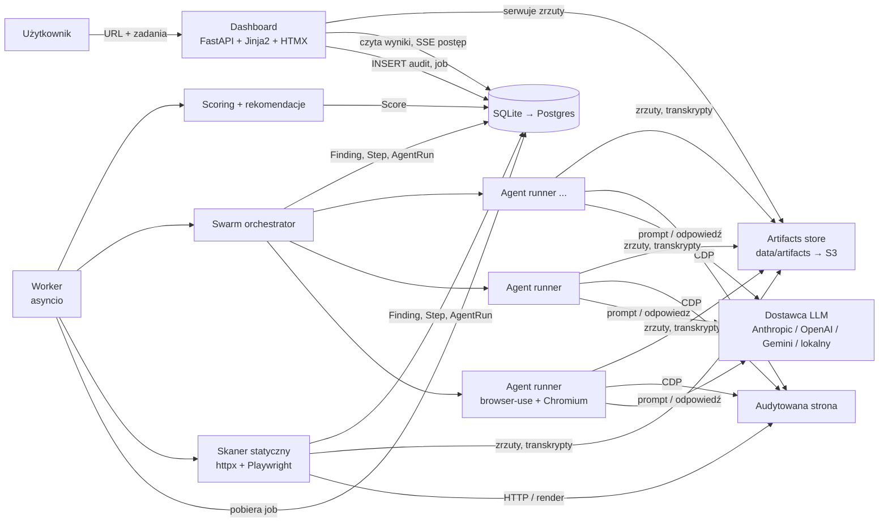
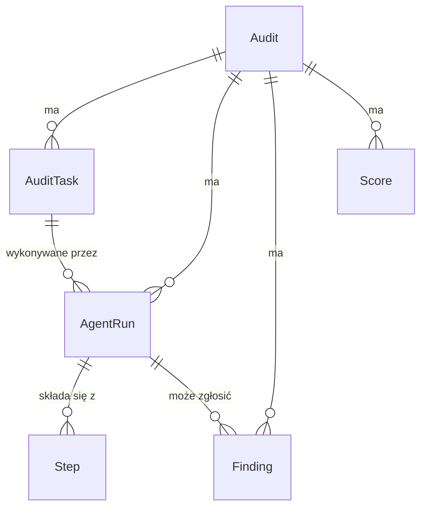

# Agent-Ready Audit — plan i architektura

> Status: **szkic do akceptacji** (2026-11-20). Kod i identyfikatory po angielsku, dokumentacja po polsku.
> Otwarte pytania, które blokują konkretne fazy, są zebrane w sekcji [13. Otwarte pytania](#13-otwarte-pytania).

## Spis treści

1. [Cel i zakres](#1-cel-i-zakres)
2. [Fakty o bibliotekach (zweryfikowane)](#2-fakty-o-bibliotekach-zweryfikowane)
3. [Architektura](#3-architektura)
4. [Model danych](#4-model-danych)
5. [Skaner statyczny — lista sprawdzeń](#5-skaner-statyczny--lista-sprawdzeń)
6. [Rój agentów — persony i zadania (YAML)](#6-rój-agentów--persony-i-zadania-yaml)
7. [Metodologia punktacji (0–100)](#7-metodologia-punktacji-0100)
8. [Roadmapa (fazy z kryteriami akceptacji)](#8-roadmapa-fazy-z-kryteriami-akceptacji)
9. [Układ repozytorium](#9-układ-repozytorium)
10. [Bezpieczeństwo i etyka](#10-bezpieczeństwo-i-etyka)
11. [Kontrola kosztów](#11-kontrola-kosztów)
12. [Abstrakcja dostawcy LLM](#12-abstrakcja-dostawcy-llm)
13. [Otwarte pytania](#13-otwarte-pytania)

---

## 1. Cel i zakres

**Cel:** narzędzie, które odpowiada na pytanie *„czy asystent AI poradzi sobie na mojej stronie?”*.
Użytkownik podaje URL i listę zadań (np. „znajdź produkt i dojdź do checkoutu”, „załóż konto”, „zaloguj się”,
„porównaj oferty”). Narzędzie:

1. robi **skan statyczny** strony (robots.txt i reguły dla botów AI, llms.txt, sitemap, schema.org, semantyczny
   HTML/ARIA, etykiety formularzy, blokady botów/CAPTCHA, publiczne API/MCP/NLWeb),
2. wypuszcza **rój agentów przeglądarkowych** (browser-use), które zachowują się jak osobisty asystent
   użytkownika: przeglądają, szukają, logują się, dodają do koszyka — i nagrywa każdy krok,
3. liczy **Agent-Readiness Score 0–100** i pokazuje w **dashboardzie webowym** raport: co agenci zrobili,
   gdzie utknęli, ile to kosztowało i co poprawić.

**W zakresie (MVP):**
- dashboard webowy od pierwszej fazy (lista audytów, formularz nowego audytu, szczegóły audytu, raport),
- skan statyczny z wynikiem częściowym,
- agenci browser-use na lokalnym Chromium, persony i zadania w YAML,
- zapis kroków: zrzuty ekranu, kod/akcje agenta, błędy, czas, koszt,
- rekomendacje poprawek powiązane z konkretnymi znaleziskami.

**Poza zakresem (na razie):**
- prawdziwe płatności i finalizacja zamówień (agent zatrzymuje się przed ostatnim krokiem — patrz §10),
- obchodzenie CAPTCHA / stealth (mierzymy, *czy* zwykły agent jest blokowany, a nie jak blokadę ominąć),
- multi-tenant SaaS, logowanie użytkowników dashboardu, płatności za narzędzie,
- audyt stron, do których nie mamy uprawnień.

## 2. Fakty o bibliotekach (zweryfikowane)

Sprawdzone 2026-11-20 na PyPI i w kodzie paczki (`browser-use==1.0.6`, wydana 2026-11-16):

| Fakt | Konsekwencja dla projektu |
|---|---|
| browser-use **1.0.6**, Python **≥3.11**. Autorzy każą przypinać dokładnie (`==`), bo API zmienia się szybko. | `browser-use==1.0.6` w `pyproject.toml`, aktualizacja tylko świadomie, po release notes. |
| 1.0 to przepisany agent na **Pydantic AI**: model pisze kod Pythona w trwałym REPL, który steruje Chrome przez **surowe CDP** (`browser-harness`). **Nie używa Playwrighta.** API 0.x (`BrowserSession`, `BrowserProfile`, callbacki kroków, `generate_gif`, `record_video_dir`, `traces_dir`) zostało usunięte. | Playwright zostaje w stacku, ale do **skanera statycznego** (render JS, snapshot ARIA, zrzut strony, deterministyczne testy) i jako źródło binarki Chromium. Agenci idą przez browser-use/CDP. |
| `Agent(task, llm=..., browser=Browser('chromium'), sensitive_data=..., output_model_schema=..., judge=True, judge_context=...)`, uruchomienie `await agent.run(max_steps=100, timeout=1700)`. | Mapuje się 1:1 na nasz `AgentRun`: limit kroków i czasu z YAML zadania. |
| Wynik (`AgentHistoryList`): `status`, `steps`, `duration_s`, `usage`, `cost_usd`, `error`, `success`, `final_result()`, `structured_output`, `messages` (pełny transkrypt z kodem i zrzutami ekranu), `judgement`. | Metryki biegu dostajemy za darmo. Kroki i zrzuty wyciągamy z `messages` po biegu. |
| `judgement` (wbudowany sędzia): `success`, `failure_reason`, `description`, `prompt_injection_detected`, `bot_block_or_captcha_detected`, `gotchas`. | Bezpośrednio zasila znaleziska (`Finding`): blokady botów, powody porażki, „pułapki” strony. |
| Brak callbacków kroków; każdy krok loguje linię INFO do `logging.getLogger('browser_use')`. | Podgląd na żywo w dashboardzie = własny `logging.Handler` zapisujący linie do bazy. |
| Modele: `ChatOpenAI`, `ChatAnthropic`, `ChatGoogle` wbudowane; dowolny string Pydantic AI (`'anthropic:...'`, `'google:...'`, `'groq:...'`); lokalnie Ollama przez `ChatOpenAI(model, base_url='http://localhost:11434/v1')`. Domyślnie `bu-4.0` na bramce Browser Use (płatny klucz `BROWSER_USE_API_KEY`). | Abstrakcja dostawcy jest prosta: jeden string modelu w konfiguracji (§12). Zawsze podajemy `llm` jawnie, żeby nie wpaść w domyślną bramkę. |
| `Browser()` bez argumentów = **chmurowa** przeglądarka Browser Use (stealth, rozwiązywanie CAPTCHA). `Browser('chromium')` = lokalny Chromium z tymczasowym profilem, headless bez ekranu. | Używamy `Browser('chromium', headless=True, allowed_domains=[...])`. Chmura z solverem CAPTCHA zafałszowałaby audyt. |
| `Browser(allowed_domains=[...])`, `prohibited_domains`, `block_ip_addresses=True` — „bariera dla posłusznego modelu, nie sandbox”. Lokalny Chromium otwiera port debugowania bez uwierzytelnienia na 127.0.0.1. | Agenci w kontenerze/osobnym użytkowniku; whitelist domen = domena audytowana. |
| `sensitive_data={'https://*.example.com': {'password': '...'}}` — model wpisuje sekret przez `type_secret()`, wartość jest maskowana w logach, ale „to nie sandbox” (zrzuty ekranu mogą ją pokazać). | Tylko konta testowe (§10). |

Playwright: aktualnie **1.65.2** (PyPI, 2026-11-20).

## 3. Architektura

### 3.1 Wybór stacku dashboardu: FastAPI + Jinja2 + HTMX

**Decyzja:** jeden proces webowy **FastAPI**, widoki renderowane po stronie serwera w **Jinja2**, interaktywność
przez **HTMX** (polling/SSE statusu audytu, częściowe odświeżanie), styl: Pico.css lub prosty własny CSS.
Bez osobnego frontendu w JS i bez kroku budowania.

Dlaczego:
- Karol zna ten układ z `ai-personal-assistant` (FastAPI + Jinja2) — zero nowej technologii.
- Cały projekt w jednym języku (Python), jedno `uv run` uruchamia wszystko.
- HTMX wystarcza do „żywego” widoku audytu (status, postęp agentów, nowe zrzuty) przez SSE albo polling co 2 s.
- Ten sam backend wystawia JSON API (`/api/...`), więc gdyby kiedyś był potrzebny bogatszy frontend
  (React/Svelte), można go dodać bez przepisywania logiki.

Odrzucone: Streamlit/Gradio (szybki start, ale słaba kontrola nad długimi zadaniami w tle i nad URL-ami
raportów), osobny SPA w React (podwójna praca na etapie MVP), Django (cięższy niż potrzeba).

### 3.2 Komponenty

| Komponent | Odpowiedzialność | Technologia |
|---|---|---|
| **Web / dashboard** | Formularz audytu, lista, szczegóły, raport, podgląd na żywo, JSON API. | FastAPI, Jinja2, HTMX |
| **Kolejka zadań** | Audyty są długie (minuty). Web tylko zapisuje `Audit(status=queued)`; worker je odbiera. | Tabela `jobs` w bazie + osobny proces workera (polling `SELECT ... FOR UPDATE SKIP LOCKED` na Postgresie / blokada w SQLite). Bez Redisa w MVP. Później ewentualnie `arq`. |
| **Worker** | Wykonuje pipeline audytu: skan statyczny → rój agentów → scoring → rekomendacje. | `python -m agent_ready.worker`, asyncio, `Semaphore` na liczbę równoległych agentów |
| **Skaner statyczny** | Zestaw niezależnych „checków” (HTTP + render Playwright). | `httpx`, `playwright` (Chromium), `selectolax`/`extruct` do parsowania HTML i schema.org |
| **Agent runner** | Uruchamia jeden `AgentRun`: persona + zadanie → `browser_use.Agent`; zbiera kroki, zrzuty, koszt, werdykt sędziego. | `browser-use==1.0.6`, lokalny Chromium |
| **Swarm orchestrator** | Rozkłada macierz persona × zadanie × powtórzenia na równoległe biegi z limitami (współbieżność, budżet, rate limit na domenę). | asyncio |
| **Scoring + rekomendacje** | Liczy wyniki kategorii i końcowy 0–100; mapuje znaleziska na poprawki. | czysty Python (łatwy do testów) |
| **Storage** | Audyty, biegi, kroki, znaleziska, wyniki. | SQLAlchemy 2 / SQLModel + Alembic; **SQLite** na start, **Postgres** gdy pojawi się hosting/wiele workerów |
| **Artifacts store** | Zrzuty ekranu, transkrypty, HTML snapshoty, raporty. | Interfejs `ArtifactStore`; implementacja `LocalArtifactStore` (`data/artifacts/...`), później S3/MinIO |
| **LLM provider** | Jedno miejsce, które z konfiguracji robi obiekt modelu dla browser-use. | `agent_ready/llm.py` (§12) |

### 3.3 Diagram



### 3.4 Przepływ audytu

1. `POST /audits` (formularz): URL, wybrany zestaw zadań (YAML z biblioteki albo wklejony), liczba powtórzeń,
   budżet. Walidacja: domena na liście dozwolonych (§10), potwierdzenie uprawnień.
2. Worker: `status=static_scan` → checki statyczne → `Finding`-i + `Score(layer=static)`.
3. `status=agents` → macierz biegów → każdy bieg zapisuje `AgentRun` + `Step`-y + zrzuty, na żywo linie logu.
4. `status=scoring` → `Score(layer=agent)`, `Score(layer=overall)`, rekomendacje.
5. `status=done` (albo `failed` / `cancelled` / `budget_exceeded`). Dashboard pokazuje raport.

## 4. Model danych



| Encja | Kluczowe pola |
|---|---|
| **Audit** | `id` (uuid7), `target_url`, `target_domain`, `status` (`queued`/`static_scan`/`agents`/`scoring`/`done`/`failed`/`cancelled`/`budget_exceeded`), `config` (JSON: zadania, persony, powtórzenia, limity, model), `budget_usd`, `cost_usd`, `created_at`, `started_at`, `finished_at`, `permission_confirmed` (bool + kto/kiedy) |
| **AuditTask** (w spec: *Task*) | `id`, `audit_id`, `task_key` (np. `checkout_reach`), `goal` (tekst dla agenta), `success_criteria`, `stop_before` (np. „przycisk płatności”), `weight`, `expected_steps`, `max_steps`, `timeout_s`, `requires_credentials` |
| **AgentRun** | `id`, `audit_id`, `task_id`, `persona_key`, `repeat_index`, `model` (np. `anthropic:claude-haiku-4-5`), `status` (`queued`/`running`/`succeeded`/`failed`/`blocked`/`timeout`/`max_steps`/`error`), `bu_status` (surowy z browser-use), `success_agent` (werdykt agenta), `success_judge` (werdykt sędziego), `success_final`, `steps_count`, `duration_s`, `tokens_in`, `tokens_out`, `cost_usd`, `final_result`, `failure_reason`, `bot_block_detected`, `prompt_injection_detected`, `gotchas` (JSON), `transcript_path`, `error` |
| **Step** | `id`, `run_id`, `index`, `ts`, `kind` (`code`/`tool`/`observation`/`log`/`error`), `action_summary` (np. „click #add-to-cart”), `code` (kod komórki REPL), `output` (zredagowany), `url`, `screenshot_path`, `error` |
| **Finding** | `id`, `audit_id`, `run_id?`, `layer` (`static`/`agent`), `category` (§5/§7), `check_key` (np. `robots.ai_bots_blocked`), `severity` (`info`/`low`/`medium`/`high`/`critical`), `status` (`pass`/`warn`/`fail`/`error`/`skipped`), `title`, `evidence` (JSON: fragment robots.txt, selektor, URL, nr kroku), `recommendation_key` |
| **Score** | `id`, `audit_id`, `layer` (`static`/`agent`/`overall`), `category` (`null` = suma warstwy), `value` (0–100), `max_points`, `points`, `details` (JSON z rozbiciem), `methodology_version` (np. `2026.1`) |

Uwagi:
- `methodology_version` na każdym wyniku — zmiana wag nie psuje porównań historycznych.
- Kroki wyciągamy z `result.messages` po biegu (komórki kodu + wyjścia + zrzuty jako `BinaryContent`); na żywo
  dashboard pokazuje linie logu (`kind=log`) z handlera `browser_use`.
- Zrzuty ekranu nie trafiają do bazy, tylko ścieżka w `ArtifactStore`:
  `artifacts/{audit_id}/runs/{run_id}/step_{index:03}.png`.

## 5. Skaner statyczny — lista sprawdzeń

Każdy check to klasa z `key`, `category`, `run(ctx) -> list[Finding]` i punktami. Nowy check = nowy plik +
test na zapisanym HTML-u (fixture), bez dotykania reszty.

| Kategoria (waga w warstwie statycznej) | Checki |
|---|---|
| **Dostęp i polityka botów (25)** | robots.txt istnieje i się parsuje; czy blokuje znane boty AI/agentów (GPTBot, ChatGPT-User, OAI-SearchBot, ClaudeBot, Claude-User, PerplexityBot, Google-Extended, …) — osobno *crawlery treningowe* (informacyjnie) i *agenty działające w imieniu użytkownika* (punktowane); czy strona odpowiada 200 dla UA agenta vs zwykłej przeglądarki; wykrycie WAF/challenge (Cloudflare, Akamai, DataDome, hCaptcha/reCAPTCHA/Turnstile) już na GET |
| **Odkrywalność (15)** | `/llms.txt` (i `/llms-full.txt`) istnieje i ma poprawny format; `sitemap.xml` (z robots lub domyślny) dostępny i aktualny; kanoniczne URL-e; czytelne URL-e |
| **Dane strukturalne (20)** | JSON-LD/microdata schema.org: `Organization`, `WebSite` + `SearchAction`, `Product`/`Offer` (cena, dostępność, waluta), `BreadcrumbList`; OpenGraph; poprawność wymaganych pól |
| **Semantyka i dostępność (25)** | landmarki (`main`, `nav`, `header`), hierarchia nagłówków; przyciski/linki z dostępną nazwą (snapshot ARIA z Playwright); `<label>`/`aria-label` w formularzach, `autocomplete` na polach login/rejestracja/adres; `alt` obrazków; elementy klikalne będące `div`-ami bez roli; treść widoczna bez JS vs po renderze |
| **Interfejsy maszynowe (15)** | publiczne API / OpenAPI (`/openapi.json`, linki w `<link rel>`); `/.well-known/` (np. `mcp`, `ai-plugin.json`, `security.txt`); endpoint MCP; NLWeb (`/ask`, `/mcp`); RSS/feedy produktowe |

Zasady: limit żądań (domyślnie ≤1 req/s na domenę), własny User-Agent identyfikujący narzędzie
(`AgentReadyAudit/0.x (+URL repo)`), timeouty, wynik checka `error` nie obniża punktów, tylko jest raportowany.

## 6. Rój agentów — persony i zadania (YAML)

Biblioteka w `tasks/` i `personas/` (w repo), możliwość wklejenia własnego YAML w formularzu audytu.

### 6.1 Persona

```yaml
# personas/busy_parent.yaml
key: busy_parent
name: "Zabiegany rodzic"
description: >
  Asystent kupujący w imieniu użytkownika, który ma mało czasu.
  Wybiera najprostszą ścieżkę, nie czyta regulaminów, porzuca, gdy coś trwa za długo.
locale: pl-PL
instructions: |          # dopisywane do system promptu agenta (extend_system_message)
  Działasz jako osobisty asystent użytkownika. Działaj jak człowiek: korzystaj z wyszukiwarki
  i nawigacji strony, nie wpisuj URL-i z pamięci. Nigdy nie finalizuj płatności.
viewport: {width: 1280, height: 800}   # albo mobile: {width: 390, height: 844}
model: default            # albo konkretny string modelu, np. "openai:gpt-..." (persona = inny asystent)
use_vision: true
```

### 6.2 Zadanie

```yaml
# tasks/ecommerce_checkout.yaml
key: checkout_reach
title: "Znajdź produkt i dojdź do checkoutu"
category: commerce        # commerce | account | discovery | support
weight: 3                 # waga w warstwie agentów
goal: |
  Znajdź na {target_url} {product_query} w cenie do {max_price} zł, dodaj do koszyka
  i przejdź do kroku płatności. Zatrzymaj się na stronie wyboru płatności.
params:
  product_query: "słuchawki bezprzewodowe"
  max_price: 300
stop_before:              # twarde punkty zatrzymania (wstrzykiwane do promptu + sprawdzane w sędzi)
  - "kliknięcie 'Zapłać' / 'Kupuję i płacę' / 'Place order'"
  - "podanie danych karty"
success_criteria: |       # trafia do judge_context
  Sukces: agent jest na stronie checkoutu/płatności z produktem w koszyku i NIE złożył zamówienia.
output_schema:            # opcjonalnie -> output_model_schema (Pydantic generowany z YAML)
  product_name: str
  price: float
  reached_checkout: bool
expected_steps: 15        # bazowa liczba kroków do oceny efektywności
max_steps: 40
timeout_s: 600
requires_credentials: false
```

```yaml
# tasks/account_login.yaml
key: login
title: "Zaloguj się na konto testowe"
category: account
weight: 2
goal: "Zaloguj się na {target_url} danymi użytkownika i otwórz stronę 'Moje konto'."
credentials_ref: test_account_1   # nazwa sekretu z .env / magazynu sekretów, nigdy wartość w YAML
success_criteria: "Sukces: widoczna strona konta zalogowanego użytkownika."
expected_steps: 6
max_steps: 20
timeout_s: 300
requires_credentials: true
```

### 6.3 Plan roju (w konfiguracji audytu)

```yaml
swarm:
  personas: [busy_parent, careful_researcher, mobile_shopper]
  tasks: [checkout_reach, login, signup]
  repeats: 2               # powtórzenia każdej pary -> stabilność wyniku
  concurrency: 4           # równoległe przeglądarki
  per_domain_rps: 1        # łączny limit dla wszystkich agentów
  budget_usd: 5.00         # twardy limit kosztu audytu
```

Macierz = persony × zadania × powtórzenia (tu 3 × 3 × 2 = 18 biegów).

## 7. Metodologia punktacji (0–100)

Wersja metodologii: `2026.1`. Wagi trzymamy w `scoring/weights.yaml`, żeby można je stroić bez zmian w kodzie.

### 7.1 Warstwa statyczna (S, 0–100)

Suma punktów z kategorii §5 (25 + 15 + 20 + 25 + 15 = 100). W kategorii każdy check ma punkty;
`pass` = pełne, `warn` = połowa, `fail` = 0, `error`/`skipped` = wyłączone z mianownika (kategoria skalowana).

### 7.2 Warstwa agentów (A, 0–100)

Dla każdego zadania *t* (z wagą *wₜ*), po wszystkich biegach (persony × powtórzenia):

| Składnik | Waga | Definicja |
|---|---|---|
| Skuteczność | 70 | odsetek biegów z `success_final = true` |
| Efektywność | 15 | `min(1, expected_steps / mediana_kroków_udanych)`; 0 gdy brak udanych |
| Brak blokad | 15 | `1 − odsetek biegów z bot_block_or_captcha_detected` |

`Aₜ = 70·skuteczność + 15·efektywność + 15·brak_blokad`, a `A = Σ wₜ·Aₜ / Σ wₜ`.

`success_final`: sukces tylko, gdy **sędzia** (`judgement.success`) potwierdza, a bieg nie naruszył `stop_before`
(naruszenie = porażka + znalezisko `critical`, niezależnie od wyniku). Czas i koszt są raportowane, ale nie
obniżają wyniku (zależą od modelu, nie od strony).

### 7.3 Wynik końcowy

- Gdy jest tylko warstwa statyczna (faza 1): pokazujemy **S** jako „Wynik częściowy (statyczny)”, nie jako
  Agent-Readiness Score.
- Pełny wynik: **Score = round(0.3 · S + 0.7 · A)**. Agenci ważą więcej, bo mierzą to, o co faktycznie chodzi
  (czy zadanie da się wykonać); statyka tłumaczy *dlaczego* i daje szybkie poprawki.
- **Twarde ograniczenie:** jeśli strona blokuje agentów użytkownika na wejściu (robots.txt zabrania
  `*-User` agentów albo challenge na każdym GET), wynik końcowy ≤ 30 niezależnie od reszty.
- Oceny: **A** ≥ 85, **B** 70–84, **C** 50–69, **D** 30–49, **F** < 30.

### 7.4 Rekomendacje

Każdy `check_key` / typ porażki agenta ma `recommendation_key` → wpis w `recommendations/*.yaml`
(tytuł, dlaczego to ważne dla agentów, jak naprawić, przykład kodu, szacowany wpływ na wynik w punktach).
Raport sortuje poprawki wg „punkty do zyskania / wysiłek”. Porażki agentów dodatkowo dostają krótkie
podsumowanie LLM z transkryptu (gdzie utknął, na jakim elemencie, z linkiem do kroku i zrzutu).

## 8. Roadmapa (fazy z kryteriami akceptacji)

Zasada: **każda faza kończy się działającym dashboardem**, a kolejna dokłada w nim nową warstwę.

### Faza 1 — Szkielet + dashboard + skaner statyczny

Dostarczamy:
- `pyproject.toml` (uv, Python 3.12), ruff, pytest, GitHub Actions (lint + testy), `.env.example`.
- FastAPI + Jinja2 + HTMX: strona główna (lista audytów), formularz „Nowy audyt”, widok audytu
  z paskiem statusu odświeżanym przez HTMX, raport statyczny (kategorie, checki pass/warn/fail, dowody, rekomendacje).
- SQLite + Alembic, modele `Audit`, `Finding`, `Score` (pozostałe tabele mogą być już utworzone).
- Worker w osobnym procesie + tabela `jobs`.
- Skaner statyczny: wszystkie kategorie z §5 (minimum 15 checków), Playwright do renderu i snapshotu ARIA,
  zrzut strony głównej w raporcie.
- `docker compose up` albo `uv run agent-ready web` + `uv run agent-ready worker`.

Kryteria akceptacji:
- [ ] Wpisuję URL w dashboardzie → w < 60 s widzę wynik częściowy S z rozbiciem na 5 kategorii.
- [ ] Każde znalezisko ma dowód (np. fragment robots.txt, selektor pola bez etykiety) i rekomendację.
- [ ] Testy jednostkowe checków na zapisanych fixture'ach HTML (bez sieci), CI zielone.
- [ ] Skaner respektuje limit 1 req/s i własny User-Agent; domena spoza allowlisty jest odrzucana.

### Faza 2 — Pojedynczy agent widoczny w dashboardzie

Dostarczamy:
- `agent_ready/llm.py` (abstrakcja dostawcy), `agent_ready/agents/runner.py` na `browser-use==1.0.6`,
  lokalny `Browser('chromium', headless=True, allowed_domains=[domena])`.
- Loader zadań/person z YAML (walidacja Pydantic), 3 zadania startowe: `checkout_reach`, `signup`, `login`.
- Zapis `AgentRun` + `Step` + zrzutów; podgląd na żywo (linie logu przez SSE/HTMX).
- Widok biegu w dashboardzie: oś czasu kroków, zrzut przy każdym kroku, kod akcji, błędy, werdykt sędziego,
  koszt i tokeny.

Kryteria akceptacji:
- [ ] Z dashboardu uruchamiam jedno zadanie na stronie testowej i oglądam postęp na żywo.
- [ ] Po biegu widzę wszystkie kroki ze zrzutami, status, czas, koszt w USD, `failure_reason` i `gotchas`.
- [ ] Agent zatrzymuje się przed płatnością na stronie demo (np. własny sklep testowy) — test e2e.
- [ ] Hasła z `sensitive_data` nie pojawiają się w bazie ani w transkrypcie (test).
- [ ] Zmiana dostawcy LLM = zmiana jednej zmiennej w `.env`.

### Faza 3 — Rój + pełny scoring

Dostarczamy:
- Swarm orchestrator: macierz persona × zadanie × powtórzenia, `concurrency`, `per_domain_rps`, `budget_usd`,
  anulowanie audytu z dashboardu.
- 3–5 person startowych (w tym mobilna), 6+ zadań (commerce, account, discovery, support).
- Scoring warstwy agentów i wynik końcowy wg §7, `methodology_version`.
- Widok roju: macierz sukcesów (persona × zadanie), mapa „gdzie utknęli” (najczęstsze URL/kroki porażek),
  rozkład kroków i kosztów.

Kryteria akceptacji:
- [ ] Audyt 18 biegów na stronie testowej kończy się w ≤ 15 min przy `concurrency=4`.
- [ ] Przekroczenie `budget_usd` zatrzymuje nowe biegi, audyt ma status `budget_exceeded` i wynik z tego, co zebrano.
- [ ] Scoring ma testy jednostkowe na zestawach syntetycznych wyników; powtórzony audyt tej samej strony daje
      wynik w granicach ±10 pkt.
- [ ] Dashboard pokazuje Agent-Readiness Score 0–100 z oceną literową i rozbiciem S / A.

### Faza 4 — Rekomendacje i raport

Dostarczamy:
- Biblioteka rekomendacji (`recommendations/*.yaml`) z szacowanym wpływem na wynik, sortowanie wg zysku.
- Podsumowania porażek z transkryptów (LLM), linki do kroków i zrzutów.
- Eksport raportu: HTML do udostępnienia, JSON (API), PDF.
- Porównanie dwóch audytów tej samej domeny (przed/po poprawkach).

Kryteria akceptacji:
- [ ] Raport ma listę „Top 5 poprawek” z punktami do zyskania i dowodami.
- [ ] Eksport HTML/PDF otwiera się bez dostępu do dashboardu.
- [ ] Porównanie pokazuje zmianę wyniku per kategoria i per zadanie.

### Faza 5 (opcjonalnie) — Produkcja

Postgres, artefakty w S3/MinIO, logowanie do dashboardu, harmonogram cyklicznych audytów, publiczne API +
badge „Agent-Ready”, wielu workerów, ewentualnie porównanie modeli (persona = konkretny asystent).

## 9. Układ repozytorium

```
viktortest/
├── README.md                 # po angielsku, krótko + link do docs/PLAN.md
├── .env.example              # komentarze po polsku, bez sekretów
├── .gitignore
├── pyproject.toml            # uv; browser-use==1.0.6, playwright, fastapi, ...
├── docker-compose.yml        # web + worker (+ postgres w fazie 5)
├── alembic/                  # migracje
├── docs/
│   └── PLAN.md
├── src/agent_ready/
│   ├── config.py             # pydantic-settings, czyta .env
│   ├── cli.py                # agent-ready web | worker | scan <url>
│   ├── db/                   # modele SQLAlchemy/SQLModel, sesja
│   ├── web/
│   │   ├── app.py            # FastAPI
│   │   ├── routes/           # audits.py, runs.py, api.py
│   │   ├── templates/        # Jinja2 (base.html, audits/*.html, partials/*.html dla HTMX)
│   │   └── static/
│   ├── worker/               # pętla jobów, pipeline audytu
│   ├── scanner/
│   │   ├── base.py           # Check, ScanContext
│   │   └── checks/           # robots.py, llms_txt.py, sitemap.py, schema_org.py, a11y.py, bot_wall.py, interfaces.py
│   ├── agents/
│   │   ├── runner.py         # jeden AgentRun na browser-use
│   │   ├── swarm.py          # orkiestracja, limity, budżet
│   │   ├── transcript.py     # messages -> Step + zrzuty
│   │   └── specs.py          # modele Pydantic dla YAML person/zadań
│   ├── llm.py                # abstrakcja dostawcy
│   ├── scoring/              # engine.py, weights.yaml
│   ├── recommendations/      # *.yaml + loader
│   └── artifacts.py          # ArtifactStore, LocalArtifactStore
├── personas/                 # *.yaml
├── tasks/                    # *.yaml
├── tests/
│   ├── fixtures/             # zapisane strony HTML, robots.txt itd.
│   └── test_*.py
└── data/                     # (gitignored) baza SQLite, artefakty
```

## 10. Bezpieczeństwo i etyka

**Uprawnienia**
- Audytujemy **tylko strony własne albo z pisemną zgodą właściciela**. Formularz audytu wymaga zaznaczenia
  potwierdzenia; zapisujemy kto i kiedy.
- `ALLOWED_TARGET_DOMAINS` w `.env` — worker odrzuca domeny spoza listy (domyślnie pusta = nic nie ruszy).
- Respektujemy ToS. Raportujemy robots.txt jako znalezisko; agenci działający „w imieniu użytkownika”
  mogą wejść na stronę, jeśli właściciel się zgodził, ale skaner statyczny nie crawluje ścieżek zakazanych dla
  naszego UA.

**Ruch i limity**
- Łączny limit żądań na domenę (`per_domain_rps`, domyślnie 1), limit równoległych przeglądarek, timeouty.
- Identyfikowalny User-Agent dla skanera; agenci używają zwykłego UA Chromium (to część pomiaru), ale
  w nagłówku/parametrze można dodać znacznik dla właściciela strony (opcja).
- Bez stealth, bez obchodzenia CAPTCHA, bez proxy rezydencjalnych.

**Brak prawdziwych transakcji**
- Każde zadanie commerce ma `stop_before`; prompt i sędzia to egzekwują, a przekroczenie = porażka `critical`.
- Dodatkowo bariera techniczna: domeny bramek płatniczych (np. `*.stripe.com`, `*.payu.com`, `*.przelewy24.pl`,
  `*.paypal.com`) w `prohibited_domains`; dane kart nigdy nie są przekazywane agentowi.
- Preferowane środowiska testowe/staging sklepu albo tryb testowy bramki.

**Dane logowania**
- Tylko **konta testowe** stworzone do audytu. Sekrety w `.env` / magazynie sekretów, w YAML tylko
  `credentials_ref`. Przekazywane przez `sensitive_data` z ograniczeniem do domeny.
- Uwaga z dokumentacji browser-use: maskowanie to nie sandbox — zrzuty ekranu mogą pokazać wpisaną wartość,
  więc zrzuty z kroków logowania oznaczamy jako wrażliwe (nie trafiają do publicznego eksportu).
- Rejestracje: adresy e-mail z dedykowanej domeny/aliasów testowych; po audycie lista kont do usunięcia.

**Izolacja**
- Lokalny Chromium browser-use otwiera nieuwierzytelniony port CDP na 127.0.0.1 → worker uruchamiamy
  w kontenerze lub na osobnym użytkowniku systemu.
- Agent wykonuje kod Pythona pisany przez model → kontener z ograniczonymi uprawnieniami, bez montowania
  katalogu domowego, bez sekretów innych niż potrzebne.
- Prompt injection ze strony: zapisujemy `prompt_injection_detected` jako znalezisko; agent nie ma narzędzi
  poza przeglądarką (bez `web_search`, bez dostępu do plików poza workspace biegu).

**Repo jest publiczne:** nigdy nie commitujemy kluczy ani haseł; `.env` w `.gitignore`, w repo tylko
`.env.example`.

## 11. Kontrola kosztów

- **Budżet na audyt** (`budget_usd`) i globalny dzienny limit (`DAILY_BUDGET_USD`); orchestrator sumuje
  `result.cost_usd` po każdym biegu i nie startuje nowych po przekroczeniu. Uwaga: koszt znany jest po biegu,
  więc limit może zostać przekroczony o koszt biegów już trwających (≤ `concurrency` biegów) — raportujemy to.
- Limity per bieg: `max_steps`, `timeout_s` z YAML zadania (browser-use przy końcu budżetu robi jeszcze jedną
  turę „oddania wyniku”).
- Tańszy model dla roju, mocniejszy tylko dla trudnych zadań / sędziego (konfigurowalne per persona).
- `use_vision: false` dla person tekstowych (tańsze tokeny), z wyjątkiem sędziego.
- Szacunek kosztu przed startem: `liczba_biegów × średni koszt biegu` (z historii), pokazywany w formularzu.
- Wczesne przerwanie: jeśli 3 pierwsze biegi zadania kończą się blokadą bota, pozostałe biegi tego zadania
  są pomijane (wynik i tak będzie 0, a oszczędzamy budżet).
- Skan statyczny nie używa LLM (koszt zero) — można go uruchamiać często.
- Dashboard pokazuje koszt per audyt / bieg / model.

## 12. Abstrakcja dostawcy LLM

```python
# src/agent_ready/llm.py (szkic)
from browser_use import ChatAnthropic, ChatGoogle, ChatOpenAI

def make_llm(model: str):
    """model w formacie 'provider:name', np. 'anthropic:claude-haiku-4-5', 'openai:gpt-...',
    'google:gemini-...', 'ollama:qwen...'. Zwraca obiekt dla browser_use.Agent(llm=...)."""
    provider, name = model.split(":", 1)
    if provider == "anthropic":
        return ChatAnthropic(name)          # ANTHROPIC_API_KEY
    if provider == "openai":
        return ChatOpenAI(name)             # OPENAI_API_KEY
    if provider == "google":
        return ChatGoogle(name)             # GOOGLE_API_KEY
    if provider == "ollama":
        return ChatOpenAI(name, base_url=settings.ollama_base_url, api_key="ollama")
    return model                             # dowolny string Pydantic AI, np. 'groq:...'
```

- Konfiguracja: `LLM_MODEL` (domyślny dla roju), `LLM_JUDGE_MODEL` (opcjonalnie), override per persona w YAML.
- Zawsze przekazujemy `llm` jawnie — bez tego browser-use używa płatnej bramki `bu-4.0` z `BROWSER_USE_API_KEY`.
- Koszt: `result.cost_usd` (browser-use liczy go przez `genai-prices`); dla modeli bez cennika `None` →
  liczymy z tokenów i własnej tabeli cen.
- Nazwy modeli zmieniają się często — trzymamy je wyłącznie w `.env`/YAML, nigdy w kodzie.

## 13. Otwarte pytania

### ❓ 13.1 Który dostawca LLM i czyj klucz API dla agentów browser-use? (blokuje fazę 2)

| Opcja | Plusy | Minusy |
|---|---|---|
| **Anthropic (Claude)** | Bardzo dobry w agentach piszących kod (a browser-use 1.0 to agent piszący Pythona); dobra wizja; Karol zna ekosystem (Claude Code); tani model Haiku-klasy dla roju + mocniejszy Sonnet-klasy dla trudnych zadań. | Potrzebny **osobny klucz API z console.anthropic.com** z płatnością za tokeny — subskrypcja Claude Code/Pro **nie** daje klucza API. Droższy niż Gemini Flash przy dużym roju. |
| **OpenAI** | Modele GPT, na których stroją się autorzy browser-use (bramka `bu-fast` = model OpenAI); dobra wizja. | Kolejne konto i rozliczenie; koszt podobny do Anthropic. |
| **Google Gemini** | Najtańszy przy dużej liczbie biegów (modele Flash), duże okno kontekstu, dobra wizja, darmowy limit na testy. | Zwykle trochę słabszy w długich, wieloetapowych zadaniach; limity darmowego planu szybko się kończą przy roju. |
| **Lokalny (Ollama)** | Zero kosztu za token, dane nie wychodzą z komputera. | Wymaga mocnego GPU; małe modele słabo radzą sobie z agentem piszącym kod i z wizją → zaniżone, niemiarodajne wyniki audytu. |
| *(Bramka Browser Use, `bu-4.0`)* | Domyślna w bibliotece, jeden klucz, modele strojone pod browser-use. | Dodatkowy pośrednik i dostawca; zachęca do chmurowych przeglądarek ze stealth, których celowo nie używamy. |

**Rekomendacja: Anthropic** jako domyślny dostawca na start — tani model Haiku-klasy dla roju
(np. `anthropic:claude-haiku-4-5`), Sonnet-klasy dla sędziego/trudnych zadań. Powód: najlepszy stosunek
jakości do kosztu w zadaniach agentowych z kodem i wizją, a Karol już pracuje z Claude. Architektura pozwala
później dodać OpenAI i Gemini jako **osobne persony** — to wręcz zaleta produktu: „czy strona działa dla
asystenta Claude, ChatGPT i Gemini”. Jeśli budżet jest priorytetem, alternatywa: Gemini Flash dla roju.

**Potrzebne od Karola:** wybór dostawcy + klucz API wpisany lokalnie do `.env` (nigdy do repo) i miesięczny
limit wydatków ustawiony w konsoli dostawcy.

### ❓ 13.2 Gdzie działa rój: domowy PC czy serwer? (blokuje decyzje w fazie 3)

- **Domowy PC (przez Tailscale, jak `ai-personal-assistant`)** — zero kosztu hostingu, łatwy dostęp do
  dashboardu z telefonu; ograniczenie: RAM/CPU (każdy Chromium ~300–500 MB → realnie 3–6 równoległych agentów),
  domowe IP może być inaczej traktowane przez WAF niż IP z chmury.
- **Serwer/VPS (np. 4 vCPU / 8 GB)** — stały dostęp, większy rój, ale koszt i IP z centrum danych (częściej
  blokowane — co samo w sobie jest ciekawym pomiarem).
- **Rekomendacja:** fazy 1–3 na domowym PC (docker compose), decyzja o serwerze w fazie 5.

### ❓ 13.3 Pierwsze strony docelowe i granice (blokuje testy e2e w fazie 2)

- Które strony audytujemy najpierw (własne/za zgodą)? Propozycja: najpierw publiczne strony **demo stworzone do
  testów automatyzacji** (np. sklepy demo typu „Sauce Demo”, `books.toscrape.com`) + własna strona Karola,
  potem strona za zgodą właściciela.
- Potwierdzenie granic: zatrzymanie przed płatnością, tylko konta testowe, brak rejestracji na produkcyjnych
  stronach bez zgody.
